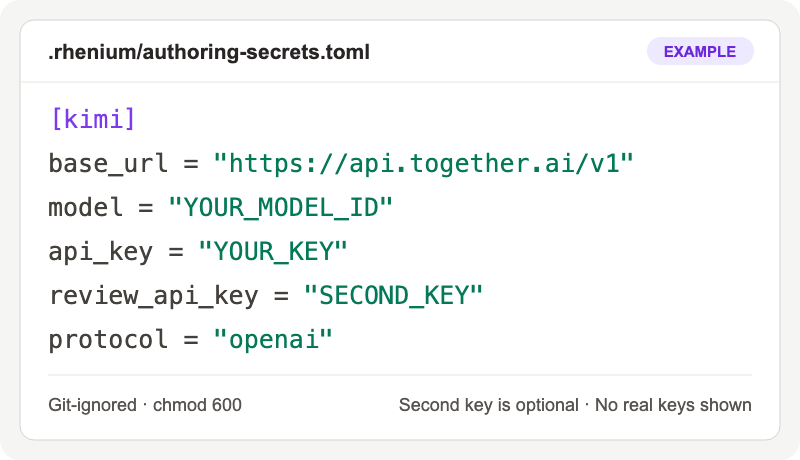
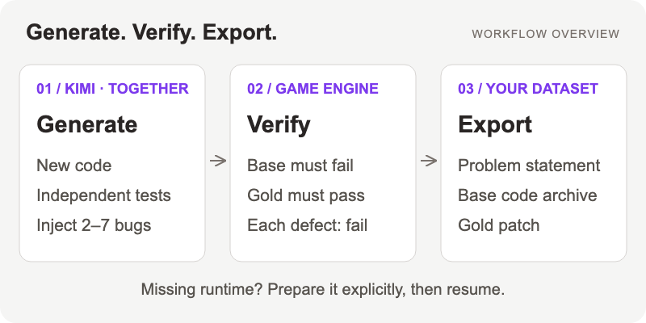

# Clean-room task authoring

## Credentials

Copy the [template](authoring-secrets.example.toml) to
`.rhenium/authoring-secrets.toml` without overwriting existing keys.
Set your endpoint, model and keys; keep the file Git-ignored with permissions `600`.



## Workflow



```sh
devenv shell -- rhenium-author model-check
devenv shell -- rhenium-author run \
  --sources github --games stardew-valley --limit 2
devenv shell -- rhenium-author status <run-id>
devenv shell -- rhenium-author export <run-id>
```

For Minecraft (Paper plugins, Java 21) point the javac preflight scripts at a
prepared verifier image so compile errors reach the model before a server boot:

```sh
export RHENIUM_MINECRAFT_CLASSPATH_IMAGE=gcb-minecraft-paper-verifier:1.21.11-132
devenv shell -- rhenium-author run \
  --sources github,modrinth --games minecraft --limit 20 --target 3 \
  --engine-account default \
  --project-check-command "$PWD/tools/authoring/checks/minecraft-project-check" \
  --verifier-check-command "$PWD/tools/authoring/checks/minecraft-verifier-check"
```

To author repository tasks from real project history instead (Minecraft only):

```sh
devenv shell -- rhenium auth login official-download
devenv shell -- rhenium-author history run --engine-account default --target 5
```

See [project-history mode](REFERENCE.md#project-history-mode).

`action_required`? [Prepare the runtime, then resume](REFERENCE.md#runtime-preparation).
Exports go to `.rhenium/authoring/exports/<run-id>/` and include gold patches—keep
them out of held-out exams. [More commands and safeguards](REFERENCE.md).
